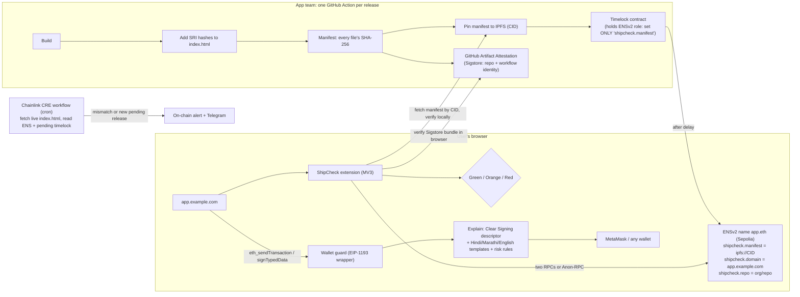

# ETHGlobal Mumbai: final idea ranking and build plan

All 12 ideas from the earlier work, ranked in one table against originality, past winners, sponsor fit and buildability. The report then picks one idea and designs it in full. Prepared 28 October 2026 for ETHGlobal Mumbai (hacking Thu 5 Nov, 9 PM to Sat 7 Nov, 9 AM IST, Classic track).

---

## 1. The answer

**Build ShipCheck, with Samjhao's "explain it in my language" step added.** The pitch: *"Sign only what's real."* Before you sign anything, it checks two things:

1. **Is this the real app?** The code your browser loaded must match the release its team published and signed, and that release must be named in the team's ENS name.
2. **What will this signature actually do?** It's explained in Hindi, Marathi or English, with a clear risk level.

**Why this one wins on every criterion:**

- **Bybit story:** the biggest crypto theft ever ($1.5B, February 2025) came from tampered website code, not a broken contract.
- **WOW demo:** change one byte of a dapp's code and the badge turns red and signing is blocked. Then a drainer permit is explained in Hindi.
- **EF's own idea:** the EF's Best CROPS App page lists "a tool that proves the shipped frontend … matches the public repo" as an example.
- **Central sponsor tech:** ENSv2 is the trust anchor, and a Chainlink CRE workflow is the alarm.
- **Day-1 integration:** it works in a normal browser with any wallet, on any dapp, from the first day.
- **Original:** similar projects exist (Verifiable Web, HackMoney 2026; WEBCAT, EF grant August 2026), but none uses ENS as the registry or adds plain-language signing in Indian languages.

**Runners-up:**

- **Samjhao alone** is the simplest strong option.
- **LeakScope** is the most original but has less prize money.
- **SocietyVote** is the best pick if you want to stay with identity.

---

## 2. One table: all 12 ideas ranked

Scores run from 1 to 5. Weights:

| Criterion | Weight | What it measures |
|---|---|---|
| Finalist potential | 35% | Technicality, originality, practicality, usability and WOW, the five things ETHGlobal's judges score |
| Sponsor prizes | 25% | Classic-track money it can credibly win, and whether sponsors have rewarded this kind of project before |
| Day-1 integration and standalone value | 15% | Works with existing systems at once, and is still useful alone |
| Buildable solo in 36 hours | 15% | Using public SDKs only |
| Scalability and security | 10% | Grows without your server becoming the bottleneck, and the threats can be defended |

| Rank | Idea | Finalist | Sponsors | Day 1 | Build | Scale/Sec | **Total** | Originality (from prior-work check) | Best sponsor picks |
|---|---|---|---|---|---|---|---|---|---|
| **1** | **ShipCheck** (+ Samjhao language step) | 4.5 | 4.5 | 4.5 | 3.5 | 4.5 | **4.35** | Medium; new with the ENSv2 registry + Indian-language signing | EF CROPS · ENSv2 · Chainlink CRE |
| 2 | Samjhao (alone) | 4 | 3.5 | 4.5 | 4.5 | 4 | **4.02** | Low saturation for Indian languages | 0G iAI · EF CROPS |
| 3 | LeakScope | 3.5 | 3.5 | 5 | 4.5 | 4.5 | **3.97** | **Most original**: no project or product found | EF Anon-RPC · ENSv2 |
| 4 | SocietyVote | 3.5 | 4 | 4 | 4 | 4 | **3.82** | Medium ("one vote per flat" is new) | EF CROPS · ENSv2 · World IDKit |
| 5 | Asli Pass | 3 | 4.5 | 4 | 4 | 4 | **3.77** | High; World ID + ENS names have won before, so it's crowded | World IDKit · ENSv2 · EF CROPS |
| 6 | TrueFrame | 4 | 4 | 3.5 | 2.5 | 4 | **3.70** | Medium (DeepTruth, Taipei 2025, won World 3rd + ENS 2nd) | ENSv2 · EF · World |
| 7 | AgentPass | 3 | 4.5 | 4.5 | 2.5 | 4 | **3.62** | Highest saturation (three near-copies at Tokyo 2026; World's own AgentKit) | World Agent Pass · Hedera x402 · ENSv2 |
| 8 | StealthPay names | 3 | 3.5 | 3.5 | 3 | 3.5 | **3.25** | High (Sneaky and ENStealth at Cannes 2026; Fluidkey) | EF · ENSv2 |
| 9 | GigProof | 3.5 | 3 | 3.5 | 2.5 | 3.5 | **3.23** | Medium (Reclaim's own "Verify Income"; no Indian data sources found) | EF · World · Chainlink |
| 10 | TraceBack (rebuilt) | 3.5 | 2.5 | 2.5 | 3 | 3.5 | **3.02** | Medium (the freeze-request step is new) | Hedera · Chainlink |
| 11 | Nominee | 3 | 3.5 | 3 | 2 | 3.5 | **3.02** | High (Afterwise 2023; Safe RecoveryHub) | EF · ENSv2 · Chainlink |
| 12 | PrivacyLayer+ (rebuilt) | 3 | 3 | 2.5 | 2 | 3.5 | **2.82** | High (Self Protocol already does Aadhaar 18+) | ENSv2 · EF |

**What moved since the earlier reports:**

- **Asli Pass and AgentPass dropped.** The prior-work check found them crowded (AgentPass most of all), and World's Orb verification is still paused in India.
- **Samjhao and LeakScope rose.** They are original and the easiest to build.
- **TrueFrame dropped on build effort.** The invisible watermark needs a separate Python service, and self-signed publisher keys show as "unknown source" in Adobe's checker.

---

## 3. What past winners show

Checked in the built-in browser and on the web on 28 October:

- **ETHGlobal Buenos Aires 2025 finalists:** Paybot, JetLagged, Hubble Trading Arena, Payload Exchange, Yoga, LensMint Camera, Halo, zkx402, Aqua0 and BMCP. Three are about agents paying (x402), which means agent payments are crowded. One, **LensMint Camera** ("tamper-proof Web3 camera with ZK authenticity"), shows that **"prove this is genuine" projects can reach the finalist round**.
- **ETHGlobal New Delhi 2025 projects lean heavily into India-specific framing:**
  - UPI-to-crypto bridges (CryptoUPI, Unipay.exchange, PyPI)
  - savings circles with identity (ROSCA-Guard, Rotare Finance)
  - World ID polling mini apps (worldvote, Credence, WYap)
  - safety reporting for Indian cities (Swarakhsha)
  - an ENS subname tool (ENS Bulk Mint)

  The showcase's finalist filter didn't apply in the browser, so these are confirmed as projects, not as finalists.
- **Sponsor precedent from the prior-work check:**
  - World and ENS have repeatedly rewarded identity-and-names builds: Worldname (Worldcoin 1st, Tokyo 2023), WNS.Vote (Worldcoin prize and ENS 2nd, London 2024) and DeepTruth (World 3rd and ENS 2nd, Taipei 2025).
  - ENS rewards projects where the name does real work.
- **From your own college:** KJSSE's "Team Somehow" won the Overall Winner prize ($6,000) at ETHPrague 2025, their second ETHGlobal podium. They are worth asking for demo and pitch advice.

**What this means for the pick:**

- Avoid the crowded lanes (agent payments, World ID + ENS passes).
- Lead with a real, local problem and one unforgettable demo moment.
- Make the sponsor tech do real work, the way ENS judges reward.

ShipCheck with the language step does all three.

---

## 4. The solution: ShipCheck, "sign only what's real"

### 4.1 Problem

- **The Bybit attack:** on 21 February 2025, attackers swapped the JavaScript Safe{Wallet} served from its AWS S3 bucket. Bybit's signers saw a normal screen and signed away more than $1.5B. Nothing in a browser checks that a site's code is the code its team published.
- **Phishing signatures:** in 2025, 106,106 victims lost $83.85M this way (Scam Sniffer). Permit signatures caused 38% of the losses in cases over $1M.
- **Language:** wallet pop-ups are English and hex, while only about 10.6% of Indians speak English (Census 2011). India leads the world in crypto adoption (Chainalysis 2025).
- **The pieces exist but aren't joined:**
  - Teams publish release hashes (Uniswap posts an IPFS CID for every web release).
  - GitHub signs build provenance (Artifact Attestations, via Sigstore).
  - The EF launched Clear Signing (ERC-7730 readable descriptions) in May 2026.
  - ENSv2 on Sepolia gives role-based record permissions.

### 4.2 What the user sees

| Badge | Meaning | Action |
|---|---|---|
| **Green: verified** | Every file matches the release signed by the team's GitHub workflow and named in their ENS name | Sign normally; the explanation panel is shown |
| **Orange: unknown** | No release published, or extra scripts seen (e.g., another extension), or the code changed since your last visit with no new release | Explanation shown with a caution |
| **Red: tampered** | A published file doesn't match | Full-page warning; signing blocked unless the user overrides |

At every signing request, a panel shows **"यह साइट आपके सारे USDC खर्च कर सकती है"** ("this site can spend all your USDC"), alongside the English, a risk level and the reason.

### 4.3 Architecture

**Components and the existing tools each one uses:**

| Part | Built with (all public, allowed in the Classic track) | Job |
|---|---|---|
| Publisher GitHub Action | GitHub Actions, `actions/attest-build-provenance` (Artifact Attestations), an IPFS pinning service, viem | One YAML file a team adds; publishes the release fingerprint |
| ENS records | ENSv2 on Sepolia: Permissioned Resolver, `grantSetterRoles` scoped to the `shipcheck.manifest` text key (the app name on its own account, because resolver roles cover every name on that account) | The tamper-proof pointer to "the real release" |
| Timelock | A small Solidity contract (Foundry) that holds the scoped role and applies a new manifest after N minutes | Gives the monitor time to raise the alarm if a CI key is stolen |
| Extension | Chrome MV3, viem ≥ 2.35 (ENSv2 reads), `sigstore-browser` (in-browser Sigstore checks), Helia or `verified-fetch` for IPFS | Badge, comparison, wallet guard |
| Explain step | `@ethereum-sourcify/clear-signing` (`format()` returns the readable intent; `formatTypedData` for permits), bundled templates, fixed risk rules | Plain-language explanation that works offline |
| Monitor | Chainlink CRE (TypeScript SDK, HTTP + EVM read/write; simulation via CLI is enough for the prize) | Checks live sites every few minutes and raises alerts |

**Binding a domain to an ENS name (anti-spoofing):** the site serves `/.well-known/shipcheck` naming `app.eth`, and `app.eth` names the domain back in `shipcheck.domain`. Both must agree, so a lookalike domain can't borrow a real project's record.

### 4.4 Works on day 1, and works alone

| Situation | What ShipCheck does |
|---|---|
| A project uses the GitHub Action | Full green/red verification |
| A project publishes IPFS release hashes (e.g., Uniswap) | Compares the live site with the latest published CID, if their hosted files match it (check before the event) |
| A project publishes nothing | **Standalone mode:** remembers each site's code fingerprint on first visit and warns when it changes with no announced release. The language explanation still works on every signature. |
| Any wallet | Wraps the page's EIP-1193 provider (EIP-6963 discovery), so MetaMask, Rabby, Coinbase Wallet and others work |
| Teams' operations | Telegram alerts from the CRE monitor and an on-chain alert log anyone can watch |

### 4.5 Scalability

- **No ShipCheck server in the trust path.**
  - The extension reads ENS from any RPC.
  - It fetches manifests by CID from any gateway and checks the hashes itself.
  - It verifies Sigstore signatures locally.
  - Ten users or ten million add no load to us.
- **Small, immutable data:** one manifest per release (tens of KB), cached forever by CID, and one ENS transaction per release.
- **Monitor limits:** CRE allows 250 KB HTTP responses and 15 requests per run. The monitor checks `index.html`, and SRI makes that cover every script, so each app costs one small request per run. Coverage grows by adding workflows.
- **The explain step is local:** descriptors and templates are bundled and cached, and new languages are just templates.

### 4.6 Security

| Threat | Defence |
|---|---|
| CDN or S3 tampering (the Bybit attack) | Hashes don't match the signed manifest named in ENS, so red and signing blocked |
| A stolen CI key publishes a malicious release | (1) The Sigstore attestation must come from the named repo and workflow. (2) The timelock delays the change. (3) The CRE monitor alerts on any new pending manifest. (4) The owner multisig cancels and revokes the role. |
| A stolen CI key changes the payout address or name | Impossible: the role covers only the `shipcheck.manifest` key. The demo shows the transaction reverting. |
| The extension is served clean bytes while the page runs bad ones | The content script re-fetches from the page's own origin and cache, not the extension's background worker, and SRI in the verified `index.html` makes the browser itself refuse changed scripts |
| A lookalike domain | Two-way domain ↔ ENS binding |
| The RPC lies about ENS | Two independent RPCs must agree, or reads go through Anon-RPC (which also stops providers seeing which sites you visit) |
| Code loaded at runtime (eval, remote chunks) | Never green; shown as orange |
| A misleading explanation | Fixed rules set the risk level. Descriptors are accepted only with reviewer attestations (ERC-8176) when available. Templates are reviewed, and the English original is one tap away. |
| ShipCheck itself is compromised | Open source (MIT), reproducible build, and ShipCheck's own release published and checked the same way |
| Privacy | Browsing history never leaves the device; no analytics |

### 4.7 Sponsors: where and how

You can pick up to three partners. Pick these:

| Sponsor and track | Requirement (from the prize page) | How ShipCheck meets it | Proof to put in the README and video |
|---|---|---|---|
| **EF: Best CROPS App** ($3,500; 1st $2,000) | One CROPS property is the reason it exists; a README CROPS section; a video of 3 minutes or less showing the moment it matters; no trackers | **S (secure) leads:** a tampered frontend is caught and signing blocked. C: works with our server off and needs no relayer. O: MIT licence, builds from the repo. P: no history leaves the browser; optional Anon-RPC reads. | The tamper moment on video; switch the server off and verification still works; CROPS section |
| **ENS: Best Use of ENSv2** ($7,000; 1st $3,000) | ENSv2 central, not cosmetic; no hard-coded values; live demo; open source | The ENSv2 name **is** the trust anchor. A scoped Permissioned Resolver role, held by a timelock, can set only `shipcheck.manifest`. The domain binding and repo pointer are ENS records. | Sepolia transactions: the CI path updates the manifest; a CI-key attempt to change `addr` reverts |
| **Chainlink: Best workflow with CRE** ($1,500, 2 × $750) | A CRE workflow (simulation is enough) connecting a blockchain with an external system, meaningfully used | The monitor: HTTP fetch of the live site plus EVM reads of ENS and the timelock, then an on-chain alert write | CRE CLI simulation log and the alert transaction |

**Alternative third pick:** **0G Build with iAI** ($5,000) instead of Chainlink, by adding an AI explanation on 0G Private Computer for contracts with no Clear Signing descriptor. It's more prize money, but 0G's flow for spending users' credits is under-documented, so only do this if 0G's workshop confirms it.

### 4.8 The 36 hours, solo

| When (IST) | Build | Done when |
|---|---|---|
| Thu 9–11 PM | Public repo (MIT), extension skeleton (MV3), demo dapp (Vite) | First commit pushed |
| Thu 11 PM – Fri 3 AM | GitHub Action: build → SRI → manifest → IPFS → attestation | A release produces a CID and a Sigstore bundle |
| Fri 3–7 AM | Sleep | |
| Fri 7–11 AM | ENSv2 Sepolia: register `shipcheck-demo.eth`, own resolver, timelock with the scoped role | The Action updates the record via the timelock; an `addr` change from the CI key reverts |
| Fri 11 AM – 4 PM | Extension: two-way binding, manifest compare, Sigstore check, green/red badge | Changing one byte turns it red |
| Fri 4–9 PM | Wallet guard + explain step (Clear Signing SDK, Hindi/English templates, risk rules) | A permit shows the Hindi warning; signing blocked on red |
| Fri 9 PM – Sat 2 AM | CRE monitor (simulate) + Telegram alert; orange/standalone mode | The alert fires on a pending malicious manifest |
| Sat 2–5 AM | README (CROPS section, partner checklist, diagram), video of 3 minutes or less | Submitted early, not at 8:59 |
| Sat 5–9 AM | Rest and rehearse | |

**Cut order if behind:** standalone mode first, then CRE (and drop Chainlink), then Marathi.

**Never cut:** the tamper → red → blocked moment and the ENSv2 scoped role.

### 4.9 Four-minute demo

1. **0:00–0:30, problem:** Bybit lost $1.5B to swapped website code, and wallet prompts are unreadable English.
2. **0:30–1:30, green:** the demo dapp shows green. A permit request is explained in Hindi as a high-risk approval.
3. **1:30–2:30, attack:** "compromise the CDN" (edit one byte), and it turns red and signing is blocked. Then a stolen CI key tries to change the payout address, and the transaction reverts.
4. **2:30–3:15, stolen key:** a malicious release is proposed through the timelock, and the CRE alert fires on Telegram before it takes effect.
5. **3:15–4:00, works everywhere:** standalone mode on a real dapp, a one-file GitHub Action for teams, and it works with the server off.

### 4.10 Prepare before 5 November (allowed: practice repos and notes only)

- Throwaway practice repos:
  - the ENSv2 Sepolia subname tutorial (mint MockUSDC, register a name, try `grantSetterRoles`)
  - a hello-world MV3 extension that hashes a page's scripts from a content script
  - a CRE CLI template run in simulation
  - `@ethereum-sourcify/clear-signing` decoding a permit
  - `sigstore-browser` verifying a public repo's attestation
- **Test whether app.uniswap.org's files match Uniswap's published release CID.** If they don't, use only the demo dapp plus standalone mode on real sites.
- Write the README skeleton text, pitch lines and Q&A answers (text only). Q&A to prepare:
  - What about Verifiable Web and WEBCAT?
  - What if the extension itself is hacked?
  - Why ENS and not a GitHub page?
- At the Thursday workshops:
  - Ask ENS whether a timelock holding a scoped resolver role counts as "central".
  - Ask the EF whether the CROPS criteria (still marked "tbc") have changed.
  - Ask Chainlink whether CRE simulation is enough.

### 4.11 Risks and fallbacks

| Risk | Fallback |
|---|---|
| ENSv2 Sepolia contract or tooling changes (frequent releases) | Pin package versions on day 1; keep the contract addresses from the tutorial |
| Sigstore in the browser is fiddly | Verify the attestation in the GitHub Action and in the CRE workflow; the extension checks the CID and ENS only |
| Prior art questions (Verifiable Web, WEBCAT) | Name them in the README. The difference: a normal browser, ENSv2 roles + timelock, a monitoring alarm, and Indian-language signing. |
| Solo time pressure | Keep the cut order above; the core demo needs only the extension, the Action and ENS |

---

## 5. If you prefer a different pick

- **Samjhao alone (simplest):**
  - A MetaMask Snap with bundled descriptors, templates and risk rules, so it needs no network permission.
  - Demo in MetaMask Flask.
  - Sponsors: 0G iAI (if you add the AI fallback) + EF CROPS.
- **LeakScope (most original):**
  - An extension that flags address leaks, with a private mode through Anon-RPC.
  - Anon-RPC is at version 0.3, and Nox is its only network on Sepolia.
  - Sponsors: EF Anon-RPC + ENSv2 privacy label.
- **SocietyVote (identity theme):**
  - Semaphore v4 with ENSv2 flat subnames.
  - The poll contract must check `scope == pollId` and freeze the group at poll start.
  - The registrar must keep the right to change each subname's resolver, or holders can fake records.
  - Sponsors: EF CROPS + ENSv2 + World IDKit.

---

## Sources

- ETHGlobal: [Mumbai prizes](https://ethglobal.com/events/mumbai/prizes) · [EF prizes](https://ethglobal.com/events/mumbai/prizes/ethereum-foundation) · [ENS prizes](https://ethglobal.com/events/mumbai/prizes/ens) · [Chainlink prizes](https://ethglobal.com/events/mumbai/prizes/chainlink) · [New Delhi 2025 event](https://ethglobal.com/events/newdelhi) · [Showcase: New Delhi projects](https://ethglobal.com/showcase?events=newdelhi) · [LensMint Camera](https://ethglobal.com/showcase?q=LensMint) · [Verifiable Web](https://ethglobal.com/showcase/verifiable-web-4nnmi)
- [KuCoin/PANews: Buenos Aires 2025 winning projects](https://www.kucoin.com/news/flash/ethglobal-buenos-aires-hackathon-announces-10-winning-projects-in-nft-defi-and-prediction-markets) · [KJSSE: Team Somehow at ETHPrague 2025](https://kjsce.somaiya.edu/en/view-announcement/875)
- [BleepingComputer: Bybit via Safe{Wallet}](https://www.bleepingcomputer.com/news/security/lazarus-hacked-bybit-via-breached-safe-wallet-developer-machine/amp/) · [Scam Sniffer 2025](https://drops.scamsniffer.io/scam-sniffer-2025-crypto-phishing-losses-fall-83-to-84-million/) · [EF Clear Signing](https://blog.ethereum.org/2026/05/12/clear-signing-announcement) · [Sourcify Clear Signing](https://docs.sourcify.dev/blog/clear-signing-launch/) · [GitHub Artifact Attestations](https://github.blog/changelog/2024-06-25-artifact-attestations-is-generally-available/) · [Uniswap IPFS releases](https://newreleases.io/project/github/Uniswap/interface/release/web%2F5.154.1) · [ENSv2 Permissioned Resolver](https://docs.ens.domains/ensv2/permissioned-resolver/) · [Indian English (Census 2011)](https://en.wikipedia.org/wiki/Indian_English)
- Research notes behind this report, with full citations for each finding: `research_notes/ETHGlobal idea ranking and build plan/` (originality_check.md, identity_feasibility.md, integrity_feasibility.md)
