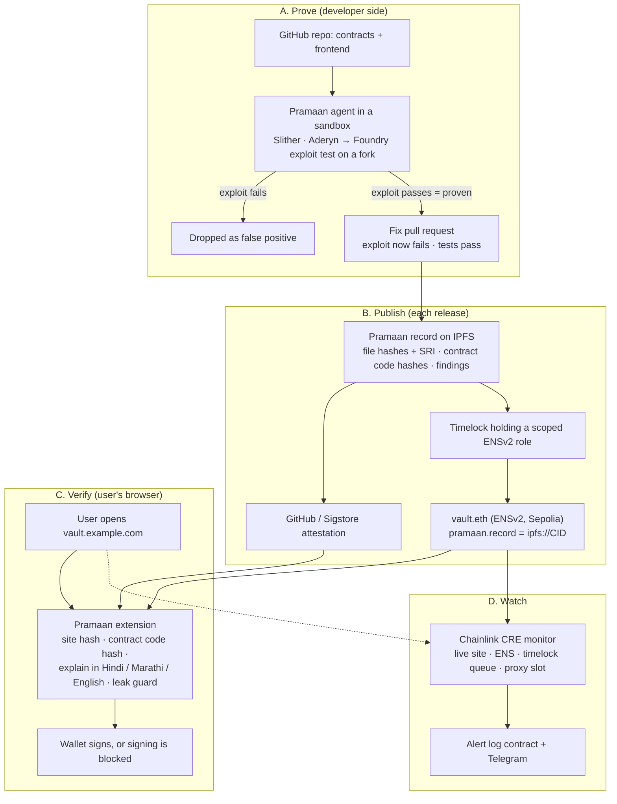
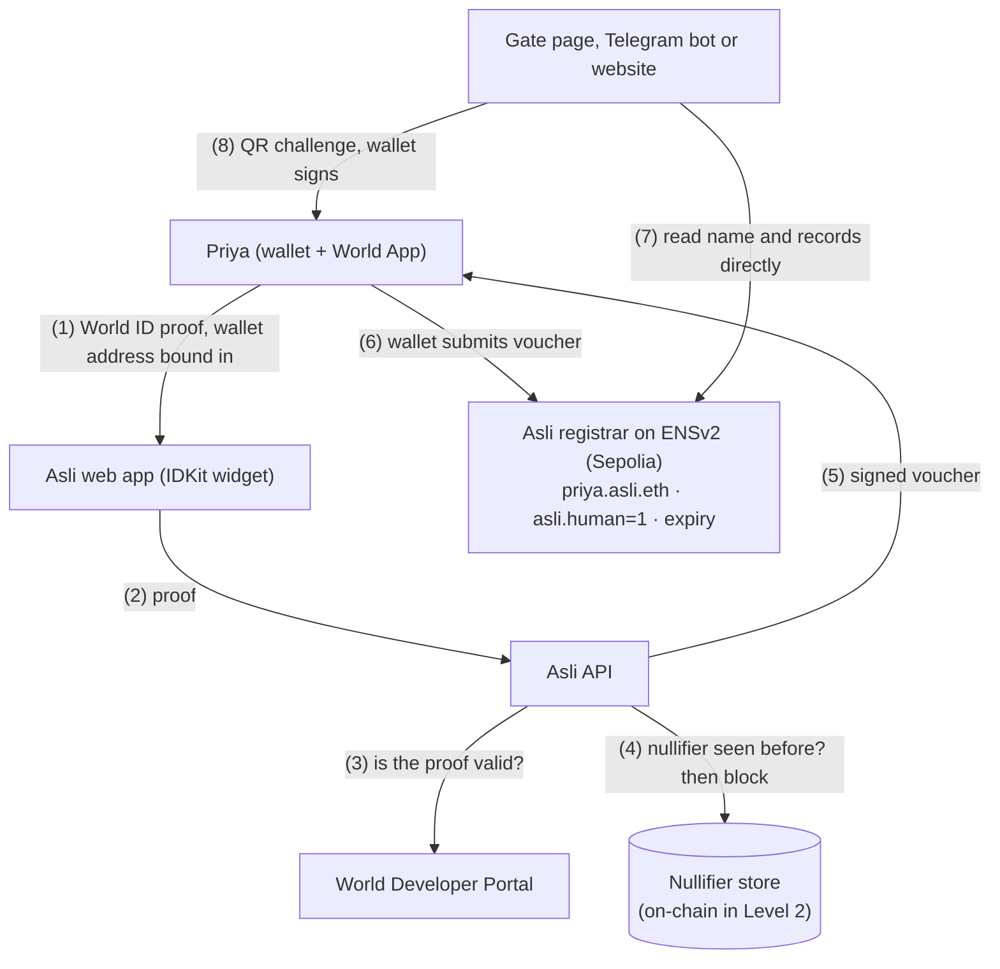
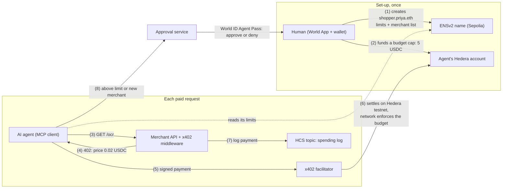
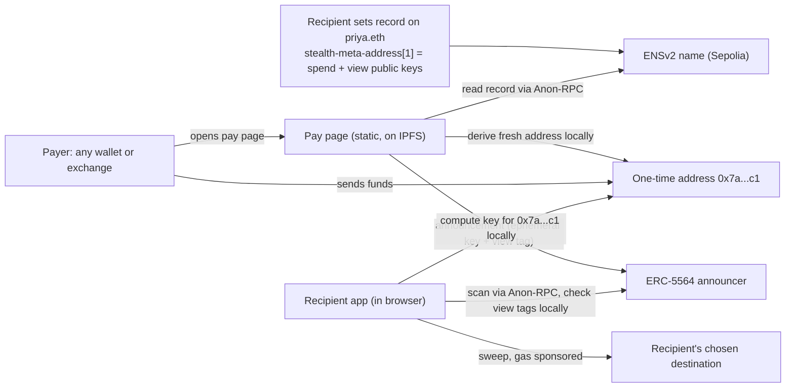

# Four Ethereum ideas for ETHGlobal Mumbai 2026, in priority order

Team discussion copy, 3 November 2026. This replaces the six-idea shortlist. ShipCheck, Samjhao and LeakScope are no longer separate ideas: they are merged with the smart-contract part of our LY project idea (the Vibe-Code Security Agent) into one new idea, **Pramaan**, which is now Priority 1. Asli Pass, AgentPass and StealthPay are kept exactly as they were in the shortlist.

---

## 0. The short answer

| Priority | Idea | One line | Sponsors (Classic track, pick up to 3) | Score /5 |
|---|---|---|---|---|
| **1** | **Pramaan** *(taken from: Vibe-Code Security Agent — mainly its smart-contract part + ShipCheck + Samjhao + LeakScope's leak check and private mode)* | Prove a dapp's contracts are safe before it ships, then let every user verify, in their own language and before they sign, that the site and contract they are using are exactly the ones that were checked | EF Best CROPS App · ENS Best Use of ENSv2 · Chainlink CRE (or Uniswap Foundation / 0G) | **4.28** |
| 2 | Asli Pass | One real human gets one pass (an ENS name) for tickets, 18+ gates and bot-free groups, with no ID photocopy | World IDKit · ENS Best Use of ENSv2 · EF Best CROPS App | 3.77 |
| 3 | AgentPass | AI agents with their own ENS name and a spending limit pay websites per request, and need a real human's approval above the limit | World Agent Pass · Hedera x402 · ENS Best Use of ENSv2 | 3.62 |
| 4 | StealthPay names | Share one name and get paid at a fresh address every time, so nobody can look up your balance or history | EF (CROPS or Anon-RPC) · ENS Best Use of ENSv2 | 3.25 |

**How scores were set:** the method from the final ranking report.

| Criterion | Weight |
|---|---|
| Finalist potential | 35% |
| Sponsor prizes | 25% |
| Day-1 integration and standalone value | 15% |
| Buildable in 36 hours | 15% |
| Scalability and security | 10% |

**Why Pramaan is first:**

- **One complete story.** Each of the merged ideas solved one link of the chain. Joined, they cover the whole path from code to signature: *the contract was proven safe → the website is the one that was published → the transaction goes to the contract that was checked → the user understands what they sign → their address isn't leaked while doing it.*
- **Deep enough for a team.** There's real work for 3–4 people, the demo has several WOW moments, and three sponsors' tech sits at its centre.
- **It's our LY head start.** It builds the smart-contract module of the LY project (Idea 1, Module D), as our LY plan already says to do at ETHGlobal.

**Classic-track rule reminder:**

- None of the merged ideas has been built yet, so starting Pramaan from scratch at 9 PM Thursday is allowed.
- Public tools and starter kits are fine. Examples: Slither, Aderyn, Foundry, Scaffold-ETH 2, the ENSv2 tutorial and the CRE templates.

---

## 1. Priority 1: Pramaan, "proven before you ship, verified before you sign"

*(taken from: Vibe-Code Security Agent — mainly its smart-contract part + ShipCheck + Samjhao + LeakScope's leak check and private mode)*

> **Pramaan** (प्रमाण, "proof") is an AI security agent that proves bugs in a dapp's smart contracts with real exploit tests, fixes them, and publishes a signed proof record in the project's ENS name. A browser guard then lets every user check, before they sign, four things, explained in Hindi, Marathi or English:
>
> - the website is the published one
> - the contract is the checked one
> - what the transaction does
> - that their wallet address isn't being leaked

### 1.1 Problem

The trust chain from a developer's code to a user's signature has four weak links today. Each one has already cost real money, and today each needs a different tool, if any tool exists at all.

| Weak link | Evidence | Today's tools |
|---|---|---|
| **1. AI-written code ships with holes** | 98% of 1,072 vibe-coded apps on Supabase had at least one flaw, 16% a critical one (Symbiotic Security, Jun 2026). Moonwell lost $1.78M when AI-co-written oracle code priced cbETH at $1.12 instead of ~$2,200. Smart-contract bugs cost $512M in 2025 (Hacken). | Audits are slow and expensive for small teams. Scanners flood developers with unproven warnings. |
| **2. Safe contracts, tampered website** | Bybit lost over $1.5B (Feb 2025) when the JavaScript served from Safe{Wallet}'s S3 bucket was swapped. The contracts were fine. | Nothing in a normal browser checks that a site's code is the code the team published |
| **3. The transaction goes somewhere else** | A tampered site or a sneaky proxy upgrade can point you at a contract no one ever checked | Wallets show an address, not "is this the audited contract?" |
| **4. Users sign what they can't read** | $83.85M stolen through phishing signatures in 2025 from 106,106 victims; Permit signatures caused 38% of the losses in cases over $1M (Scam Sniffer). Only ~10.6% of Indians speak English (Census 2011), yet India leads crypto adoption (Chainalysis 2025). | English, hex and jargon in wallet pop-ups |
| **5. Your address leaks while you do it** | 211 of 616 dapps leaked users' wallet addresses to third parties (USENIX Security 2023). Wallet extensions with 35M users link addresses through RPC calls (PoPETs 2026). | No consumer tool shows or blocks it |

**The gap:** audit firms, scanners, transaction warnings and privacy tools are separate, and **none publishes one verifiable record that a user's browser can check at the moment of signing**.

### 1.2 Solution: one chain of proof, four stages

| Stage | Who | What Pramaan does | Comes from |
|---|---|---|---|
| **A. Prove** | Developer (GitHub App, CLI or GitHub Action) | Static analysis (Slither, Aderyn) finds candidate bugs. The AI agent writes a **Foundry exploit test** for each one and runs it on a forked chain in a sandbox. **No proof, no finding.** It then proposes a fix pull request and proves the fix: the exploit must now fail and the project's tests must pass. It also scans the frontend bundle for leaked keys and for trackers that send wallet addresses. | Vibe-Code Security Agent, Module D (+ LeakScope at build time) |
| **B. Publish** | The release pipeline | One **Pramaan record** per release, pinned to IPFS and signed with GitHub's Sigstore attestation. It holds the file hashes (with SRI added), the deployed contract addresses and bytecode hashes, the proven findings and fixes, the tool versions, and the third parties the app uses. A timelock contract holding a narrow ENSv2 role writes the record's address into the project's ENS name. | ShipCheck + Security Agent's "on-chain audit record" |
| **C. Verify** | Every user (browser extension, any wallet) | It checks four things before a signature: (1) the **site** matches the record; (2) the **contract** being called has the bytecode hash listed in the record, including proxy implementations; (3) **what the transaction does**, explained in Hindi, Marathi or English with a risk level; (4) whether the page is **sending your address** to third parties, with a one-switch private mode. | ShipCheck + Samjhao + LeakScope |
| **D. Watch** | Anyone (alerts) | A Chainlink CRE workflow checks live sites, ENS records, pending timelock changes and **proxy upgrades** against the record, and raises alerts on-chain and on Telegram | ShipCheck monitor, extended to contracts |

**Where each merged idea lives in Pramaan:**

| Merged idea | What was taken | Where it is in Pramaan |
|---|---|---|
| Vibe-Code Security Agent (smart-contract part) | Prove → fix → re-prove with exploit tests, sandbox, "no proof, no finding", fix pull requests, on-chain audit record | Stage A; the findings in the Stage B record |
| ShipCheck | Release manifest + SRI, GitHub/Sigstore attestation, ENSv2 scoped record held by a timelock, two-way domain binding, green/orange/red site check that blocks signing, first-seen fingerprint for apps that publish nothing, CRE monitor | Stage B, Stage C check (1), Stage D |
| Samjhao | Clear Signing descriptors (ERC-7730), fixed risk rules, Hindi/Marathi/English templates, optional 0G Private Computer AI fallback | Stage C check (3), the "explain layer" |
| LeakScope | Build-time tracker scan, run-time leak detection, block rules, private mode via Anon-RPC, declared-vs-actual third-party list, frame guard | Stage A (build-time scan), Stage C check (4), the `thirdParties[]` field of the record |
| New in the merge | The contract code-hash check (is this the audited contract, including proxy implementations) and the monitor's proxy-upgrade alert | Stage C check (2), Stage D |

**What the user sees before signing (one panel):**

```
Pramaan ✔ Site: verified release v1.4 (signed by org/vault-app, 6 Nov)
        ✔ Contract: VaultV2 — the audited one · 1 critical issue fixed, proof on record
        ⚠ This action: "यह साइट आपके सारे USDC खर्च कर सकती है"
          (this site can spend ALL your USDC) — unlimited approval  [English ▸]
        ✔ Privacy: no third party received your address · private mode ON
```


### 1.3 Who uses it on day 1, and how it plugs into existing systems

| Existing system | How Pramaan uses it |
|---|---|
| **GitHub** (App, Actions, Artifact Attestations / Sigstore) | Developers connect a repo or add one workflow file. Fixes arrive as pull requests. Records are signed with GitHub's own build identity. |
| **Foundry / Hardhat projects, Slither, Aderyn, Sourcify** | The agent runs the tools teams already use. Contracts are checked against Sourcify-verified source. |
| **ENS** (read by every major wallet and library) | The project's own name holds the pointer to its Pramaan record |
| **IPFS** | Records and release files are content-addressed and verified locally |
| **Chrome, Brave, Edge + MetaMask, Rabby, Coinbase Wallet** (EIP-1193, EIP-6963) | The extension wraps the page's wallet provider, so it works with whatever wallet the user already has |
| **EF Clear Signing registry** (ERC-7730) and the Sourcify clear-signing library | Exact, reviewed descriptions of contract calls, which Pramaan translates |
| **Anon-RPC** | Private mode for the page's reads |
| **Chainlink CRE, Telegram** | Monitoring and alerts that teams and users can subscribe to |

**Still useful standalone, even if no project adopts it yet:**

- **For users:** every signature is explained in their language with risk rules. Address leaks are shown and can be blocked. The extension remembers each site's code fingerprint and warns when it changes with no announced release. It shows whether the contract you're calling is verified on Sourcify.
- **For developers:** proven findings and fix pull requests on their own repo, with nothing published.

**Day-1 users:** vibe-coding and small web3 teams who can't afford a full audit, hackathon teams, DeFi and Safe users, and new Indian crypto users.

### 1.4 System design



**Inside each part, with the existing tools to use (all public, allowed in the Classic track):**

| Part | Tools | Key design choices |
|---|---|---|
| **Agent orchestrator** | Python + LangGraph (as in the LY plan), or a simple TypeScript state machine for the hackathon | Fixed steps with retries and full logs, so every run can be replayed |
| **Sandbox** | Docker (gVisor later), `anvil` fork, Foundry | One fresh container per job, network off except an allow-list, code deleted after the job, secret values masked before any model call |
| **Bug classes for the hackathon** | Slither and Aderyn detectors plus exploit templates for **missing access control, reentrancy, unchecked oracle maths, unprotected upgrade/initializer** (and, as an option, **Uniswap v4 hook** callbacks not limited to the PoolManager) | The model fills in a template for the specific contract instead of writing exploits from nothing, which is more reliable |
| **Pramaan record** | JSON schema plus IPFS pinning; Sigstore via `actions/attest-build-provenance` | Fields: app, domain, repo, commit, workflow; `files[]` (path, sha256); `contracts[]` (chainId, address, codehash, proxy implementation codehash, Sourcify match); `findings[]` (class, severity, status, exploit-test hash, fix commit); `tools[]` (name@version); `thirdParties[]` |
| **ENS records** | ENSv2 on Sepolia: Permissioned Resolver, `grantSetterRoles` scoped to `pramaan.record` and `pramaan.domain`. The app's name sits on its own account, because resolver roles cover every name on that account. | The timelock (a small Foundry contract) holds the role, so a new record takes effect only after N minutes. The owner multisig can cancel or revoke. Two-way binding: the site's `/.well-known/pramaan` names `vault.eth`, and `vault.eth` names the domain. |
| **Extension** | Chrome MV3, viem ≥ 2.35 (ENSv2 reads), `sigstore-browser`, Helia / verified-fetch, `@ethereum-sourcify/clear-signing` | Content script re-fetches same-origin files (the page's cache) and checks SRI. The wallet guard wraps EIP-1193. Contract check: `eth_getCode` → keccak → compare with the record; for proxies, read the EIP-1967 implementation slot. |
| **Explain layer** | Clear Signing `format()` / `formatTypedData()` + bundled templates (Hindi, Marathi, English) + fixed risk rules | Works offline. The AI can never lower a risk level, and the English original is one tap away. For contracts with no descriptor there's an optional AI explanation on 0G Private Computer, clearly labelled as AI. The same logic can later ship as a MetaMask Snap, with Tamil and Bengali templates. |
| **Leak guard** | `webRequest` (observe request bodies) + `declarativeNetRequest` (block) + the `@anon-rpc/browser-extension-harness` (offscreen document) | Flags your address, ENS name and common hashed forms going to third parties. Private mode blocks those requests and routes reads through Anon-RPC. It also compares what it sees with the `thirdParties[]` list the app declared in its Pramaan record (LeakScope's "privacy label": declared vs actual). A frame guard stops the wallet being exposed to cross-origin frames. |
| **Monitor** | Chainlink CRE TypeScript SDK; HTTP + EVM read/write; CLI simulation | Fits CRE's limits (250 KB responses, 15 requests per run) by checking `index.html` + SRI, the ENS record, the timelock queue and the EIP-1967 slot. Hashes with a pure-JS library because CRE has no `node:crypto`. |

### 1.5 How it works, step by step (demo flow)

1. **Prove:** the team connects the repo of a sample vault contract written with an AI tool. The agent flags "missing access control on `withdrawAll`". It writes an exploit test, and on the fork an attacker drains the test funds, which is the proof. It opens a fix pull request, re-runs the exploit (now it fails) and the tests pass.
2. **Publish:** merging the fix triggers the release. The build, SRI, Pramaan record, attestation and timelock run, and after the delay `vault.eth` points to the new record.
3. **Verify:** a user opens the vault site.
   - Badge: green.
   - Panel: "verified release · audited contract · 1 critical fixed".
   - The approve request is explained in Hindi as an **unlimited approval**.
   - Leak guard: an analytics script was about to receive the address; private mode blocks it.
4. **Attack 1:** change one byte of the site's JavaScript. The badge turns **red** and signing is blocked.
5. **Attack 2:** the page swaps the contract address to an unaudited copy. The guard shows **orange**: "this contract is not the one Pramaan checked".
6. **Attack 3:** a stolen CI key proposes a malicious record, or the owner upgrades the proxy to unaudited code. The CRE monitor raises an alert on Telegram **before** the timelock lets the record change, and flags the upgrade.

### 1.6 Scalable architecture

- **The user side has no Pramaan server in the trust path.**
  - The extension reads ENS from any RPC and fetches records by CID from any gateway.
  - It verifies the Sigstore signature and the hashes itself.
  - A million users add no load to us.
- **The developer side scales like a CI service.**
  - Scans are jobs on a queue, and each runs in its own short-lived sandbox.
  - Workers scale horizontally.
  - Cost is per release, not per user.
- **The data is small and immutable:** one record per release (tens of KB), cached forever by CID, and one ENS transaction per release.
- **Monitoring is spread out:** one CRE workflow per app (or per group of apps), each a few small requests per run.
- **Coverage grows with templates, not retraining:** new bug classes are new exploit templates, and new languages are new translation templates.
- **Later (LY project):** a fine-tuned small model trained on our proven fix pairs for local mode (code never leaves the laptop), plus web-app and AI-feature modules (Modules A–C of the LY plan).

### 1.7 Security

| Threat | Defence |
|---|---|
| **Untrusted repo code attacks our infrastructure** | A fresh sandbox per job with no network except an allow-list. Keys stay outside the sandbox. GitHub App tokens cover chosen repos only and expire in about an hour. Code is deleted after the job. |
| **Prompt injection in the repo** (comments telling the AI to ignore a bug) | The exploit result decides, not the AI's opinion. A finding is only reported, or only cleared, by running tests. |
| **The AI invents findings** | "No proof, no finding": anything without a passing exploit test is dropped and logged as a false positive |
| **A bad fix** | The fix must make the exploit fail **and** keep all project tests passing, and it arrives as a pull request a human merges. We never push to the main branch. |
| **A fake or forged Pramaan record** | The record must be signed by the named repo's GitHub workflow (Sigstore identity) and named in the project's ENS name |
| **A stolen CI key** | The key can only queue a change to two text keys. The timelock delays it, the CRE monitor alerts, and the owner multisig cancels and revokes. It can't touch the address record or ownership. |
| **CDN or S3 tampering (Bybit)** | File hashes and SRI don't match the record, so the badge turns red and signing is blocked |
| **Contract swap or a sneaky proxy upgrade** | The guard compares the called contract's code hash, and the proxy implementation, with the record. The monitor flags upgrades the record doesn't list. |
| **Lookalike domain** | Two-way binding between the site and its ENS name |
| **RPC lies** | Two independent RPCs must agree, or reads go through Anon-RPC |
| **A misleading explanation** | Fixed rules set the risk level. Clear Signing descriptors are trusted only with reviewer attestations (ERC-8176) when available. Templates are reviewed, and the English original is one tap away. |
| **Our extension is compromised** | MIT licence, reproducible builds, and our own release published and checked by Pramaan itself |
| **"Audited" read as "100% safe"** | The panel says what was proven and fixed, and lists the bug classes checked. It never says "safe". |
| **Scanning someone else's app** | Active tests only on repos the user owns or is authorised for (GitHub App permission; a DNS or file token for live URLs) |

### 1.8 CROPS: how Pramaan helps each property

| Property | How |
|---|---|
| **S: secure (the lead property)** | Proven-exploit audits, a tamper-proof release record, contract code-hash checks and plain-language signing, at the one moment that matters: before the user signs |
| **C: censorship-resistant** | Verification needs nothing from us: records live in ENS and IPFS, the extension works offline, and the monitor runs on Chainlink's network. Switch our servers off and users can still verify. |
| **O: open source** | MIT licence; the agent, the record schema and the extension can all be built from the repo; exploit tests are published with the fixes |
| **P: private** | The leak guard shows and blocks address sharing, private mode routes reads through Anon-RPC, there's no telemetry, and the agent's local mode keeps code on the developer's laptop |

### 1.9 Sponsors: where and how (pick up to 3)

| Sponsor and track | What they require | How Pramaan meets it | Proof in the submission |
|---|---|---|---|
| **EF: Best CROPS App** ($3,500; 1st $2,000) — *recommended* | One CROPS property is the reason it exists; a README CROPS section; a video of 3 minutes or less showing the moment it matters; no trackers | S leads (section 1.8), the other three hold, and it works with our server off | The video's tamper moment and contract-swap moment; server switched off and verification still works |
| **ENS: Best Use of ENSv2** ($7,000; 1st $3,000) — *recommended* | ENSv2 central, not cosmetic; no hard-coded values | The project's ENSv2 name **is** the trust anchor for each release. A scoped resolver role held by a timelock, plus two-way domain binding. | Sepolia transactions: the record update via timelock; a CI-key attempt to change `addr` reverts |
| **Chainlink: Best workflow with CRE** ($1,500, 2 × $750) — *third pick if the monitor ships* | A CRE workflow (simulation is enough) connecting the chain with an external system, meaningfully used | The monitor: HTTP fetch of the live site + EVM reads of ENS, the timelock and proxy slots → on-chain alert write | CRE CLI simulation log and the alert transaction |
| **Uniswap Foundation: Build with Uniswap** ($10,000; 1st $4,000) — *alternative third pick* | Build on or integrate any part of the Uniswap stack, including tooling for the ecosystem; FEEDBACK.md; README pointing to the code | Add a **Uniswap v4 hook module**: exploit templates for common hook mistakes (callbacks callable by anyone, wrong delta accounting), proven on a forked v4 pool | Exploit + fix tests on a v4 hook, FEEDBACK.md, the developer feedback form |
| **0G: Build with iAI** ($5,000) — *alternative third pick* | Credits spent inside the app; inference on 0G Private Computer; a reason to return | The agent's reasoning and the AI fallback explanation run on 0G Private Computer (an enclave), so a team's private code never goes to an ordinary AI company. Every new release brings them back. | Compute request IDs in the video. 0G's flow for spending users' credits is under-documented, so confirm it at the 0G workshop first. |

**Recommended:** EF + ENS + Chainlink (the safest). Swap Chainlink for **Uniswap** if a teammate can deliver the v4 hook module: it's more money but more work.

### 1.10 What to build in 36 hours (team of 3–4)

| Lane | Owner | Must ship | Should ship | Stretch |
|---|---|---|---|---|
| **1. Agent** | AppSec / AI lead | Slither + Aderyn run in a sandbox; exploit templates for 2 bug classes (access control, reentrancy); prove → fix pull request → re-prove on the sample vault | Oracle maths and unprotected initializer templates | Uniswap v4 hook module; 0G Private Computer for the model |
| **2. Publish + ENS** | Platform lead | GitHub Action: build → SRI → record → IPFS → Sigstore; ENSv2 name with scoped role held by a timelock | Two-way domain binding; contract code hashes and proxy info in the record | Public record page on IPFS |
| **3. Extension** | Front-end lead | Green and red site check; contract code-hash check (orange); wallet guard | Leak guard (observe + block) | Private mode via Anon-RPC (Nox on Sepolia) |
| **4. Explain + monitor + story** | Product lead | Hindi + English explanations for approve, permit, transfer; README with CROPS section and partner checklist; video | CRE monitor (simulation) with Telegram alert; Marathi | Proxy-upgrade detection in the monitor |

**Cut order if behind:** private mode, then the Uniswap module, then Marathi, then the CRE monitor (and drop Chainlink).

**Never cut:** prove → fix → re-prove, the tamper → red → blocked moment, and the ENSv2 scoped record.

**If solo:** build lanes 2 and 3, plus lane 4's explanation, which is the earlier ShipCheck + Samjhao plan. Present the agent as one proven exploit run from the CLI.

### 1.11 Four-minute demo script

| Time | What we show |
|---|---|
| 0:00–0:30 | **Problem:** AI writes our contracts; Bybit's contracts were fine but its website wasn't; users sign English hex they can't read |
| 0:30–1:30 | **Prove:** the agent drains the sample vault on a fork (proof), opens the fix pull request, and re-runs: the exploit fails and the tests pass |
| 1:30–2:15 | **Publish + verify:** the record lands in `vault.eth`; the user's panel shows verified site + audited contract + a Hindi warning about an unlimited approval |
| 2:15–3:15 | **Attacks:** one byte changed → red and blocked; contract swapped → orange; stolen-key record or proxy upgrade → CRE alert on Telegram before it takes effect |
| 3:15–4:00 | **Why it matters:** works with any wallet, works with our server off (CROPS), one workflow file for teams, and it becomes our LY project |

### 1.12 Honest risks

| Risk | What to do |
|---|---|
| **Scope**, the biggest risk | Keep the cut order; agree on the record schema in the first hour so all four lanes can work in parallel |
| **AI exploit writing is unreliable** | Use templates per bug class with the model filling in specifics; demo on a sample contract we wrote in the hackathon for exactly these bug classes, and say so |
| **Prior art** | Verifiable Web (HackMoney 2026) and WEBCAT (EF grant, Aug 2026) do frontend checks; AI auditors and Blockaid-style warnings exist. Name them in the README. Our difference: one signed record joins the proven audit, the live site, the contract called and the user's signature, in Indian languages, with leak protection. |
| **Tooling churn** | ENSv2, Anon-RPC 0.3, CRE and clear-signing releases are frequent; pin versions on day 1 |
| **Chrome limits** | Extensions can't read response bodies, so re-fetch same-origin files in the content script and rely on SRI; never call green what couldn't be checked |
| **"Audited" over-trust** | The panel lists what was checked and proven, never "safe" |

### 1.13 Prepare before Thursday (practice repos and notes only)

- Throwaway practice runs:
  - Slither and Aderyn on a sample contract
  - a Foundry exploit test on an `anvil` fork
  - the ENSv2 Sepolia tutorial with `grantSetterRoles`
  - an MV3 extension that hashes page scripts
  - the clear-signing library decoding a permit
  - `sigstore-browser` verifying a public attestation
  - a CRE template in simulation
- Write the record schema and the README skeleton as text notes. Writing them in the project repo before Thursday is not allowed.
- At the workshops:
  - Ask ENS whether a timelock holding a scoped resolver role counts as "central".
  - Ask the EF whether the CROPS criteria (still marked "tbc") have changed.
  - Ask Chainlink whether simulation is enough.
  - Ask 0G how an app spends users' credits.

---


## 2. Priority 2: Asli Pass, "one real human, one pass"

> Prove you're a real, unique person once, get one ENS name (priya.asli.eth) with yes/no claims and an expiry, and use it at ticket drops, 18+ gates and bot-free groups. Nobody sees your ID.

### 2.1 Problem

- **Bots and scalpers win ticket drops.** For Coldplay's Mumbai shows (January 2025), about 1.3 crore people tried to book roughly 1.8 lakh tickets. Resale listings appeared at about five times face value, a complaint alleged ticket bots, and Mumbai's Economic Offences Wing summoned BookMyShow's CEO. The platform's "4 tickets per user" cap can't stop one person with many accounts.
- **Offline, we hand over ID photocopies** at fests, hostels, hotels and SIM shops. Each copy leaks name, address, birth date and ID number, when the gate only needs "real person?" and sometimes "18+?".
- **Online communities** (Telegram and Discord groups, airdrops, polls) are flooded with fake and duplicate accounts.
- **The market is moving here.** World says 18 million people have verified in 160 countries, and in April 2026 it announced partnerships with Tinder, Zoom and DocuSign, plus "Concert Kit", which lets artists reserve tickets for verified humans.

### 2.2 Solution

1. The user proves they are a unique human with **World IDKit**, picking the lightest credential that is enough: **Proof of Human** for "one per person", **Passport/NFC** when 18+ matters (confirm with World what it reveals), **Selfie Check** for liveness at high-value drops. Their wallet address is bound into the proof.
2. Asli checks the proof and blocks repeat **nullifiers** (one per person per action, and unlinkable across apps). It issues **label.asli.eth** on **ENSv2** with text records such as `asli.human=1`, `asli.18plus=1` and an expiry.
3. Any gate, bot or website checks the name with standard ENS tools. **It still works with Asli's server switched off.**
4. At a physical gate, the volunteer's phone shows a QR challenge and the holder's wallet signs it, so a screenshot of someone else's pass doesn't work.

### 2.3 Who uses it on day 1, and how it plugs in

| Existing system | How Asli Pass uses it |
|---|---|
| World App, World ID Simulator, Sandbox app | Verification, without building any identity system yourself |
| ENS (read by MetaMask, Rainbow, Coinbase Wallet, viem, ethers) | The pass is a normal ENS name: no new app is needed to read it |
| Telegram and Discord | A bot that lets someone into a group only with a valid pass (the first real verifier, live on day 1) |
| Existing logins (OpenID Connect) | "Sign in with World ID" uses OIDC, so sites on Auth0, Okta or Firebase add it like Google login |
| Ticketing and forms (Luma, Google Forms, Townscript and similar) | A pass-check link or webhook that exports "verified, one per person" before payment |

**Day-1 users:** college fest organisers, community admins, small event organisers, airdrop and poll organisers.

### 2.4 How it works



### 2.5 Scalable architecture

- **Verification is on the read path, and reads are free.** Gates and bots read ENS from any RPC. A million gate checks cost Asli nothing and don't touch its server.
- **Issuance is the only write**, once per person per event or season. The API is stateless: it checks the proof, signs a voucher and the user pays the gas. It scales horizontally behind a load balancer.
- **Level 2 moves the nullifier on-chain** inside the registrar contract, so the server keeps no data at all.
- **Many issuers, one standard:** colleges or event companies run their own parent name (fest.college.eth) with the same records, and verifiers keep a list of trusted parents.

### 2.6 Security

| Threat | Defence |
|---|---|
| One person farms many passes | World ID nullifier for the action, so a second claim is blocked |
| A stolen proof is replayed by someone else | The wallet address is bound into the proof (the "signal"), and the voucher is tied to that address, a nonce and an expiry |
| Screenshot or pass sharing at a gate | Live QR challenge signed by the name's owner wallet |
| The issuer's key leaks | Key in a cloud KMS, scoped ENSv2 role (registrar only), short voucher expiry, rotate by changing the role |
| Asli goes offline or is censored | Existing passes keep working because gates read the chain. Only new sign-ups pause. |
| Privacy leaks | Claims are yes/no only, with no names, birth dates, phone or ID numbers. The nullifier can't be linked across apps. No IP logs, no analytics. |
| "18+ on-chain is a leak" | It's an opt-in yes/no, not a birth date. Later: keep claims off-chain and show the gate a fresh signed answer. |

### 2.7 Sponsors: where and how

| Sponsor and track | What they require | How Asli Pass meets it | Proof in the submission |
|---|---|---|---|
| **World: Best Use of IDKit** ($2,500) | IDKit in a working app; verify on the server or on-chain; explain the trust event and why the credential is the minimum sufficient one; show success and one alternative path; integration debrief | Trust event: "one ticket per real person". Proof of Human is the minimum for that, Passport/NFC is only for 18+ gates, and Selfie Check is for high-value drops. Server-side verification, and a repeat claim is denied. | Video: a second wallet is blocked. The README has the "why this credential" paragraph and the debrief. |
| **World: Agent Pass** ($5,000, optional) | A meaningful action protected by human identity or approval; a denied path; backend validation | Add "agent passes": a verified human registers a ticket-buying agent (agent.priya.asli.eth) and must approve with World before it buys | Only with a teammate. It's still one World pick. |
| **ENS: Best Use of ENSv2** ($7,000) | ENSv2 central, not cosmetic; no hard-coded values | The subname **is** the pass, its expiry **is** the pass's expiry, and claims are records any app reads. The registrar holds only the registrar role on asli.eth (Enhanced Access Control). | Sepolia transactions, and the gate reading records live |
| **EF: Best CROPS App** ($3,500) | One property is the reason it exists, plus the README section, video and no trackers | **P (private) is the lead property.** The gate learns only yes/no and the server keeps no personal data. C: it verifies with the server off. | Video: server off, gate still green, empty server logs |

### 2.8 What to build in 36 hours

- **Must ship:** the IDKit widget, API verification and the nullifier block; the ENSv2 subname with records and expiry; a gate page with a green tick; the second-wallet-blocked demo.
- **Should ship:** the voucher plus registrar contract (nullifier on-chain), the QR wallet-signature check, and the Telegram bot.
- **Stretch:** the Passport/NFC 18+ claim, agent passes, and a gate page hosted on IPFS.

### 2.9 Honest risks

- **World ID for Indian users:** World stopped Orb (iris) verification in India in late 2023, and I found no report of it returning. For the hackathon this doesn't matter, because the simulator and Sandbox app are accepted. For real Indian users, Asli would need a credential that doesn't need an Orb (Passport/NFC or Selfie Check, if World enables them in India; ask at the World booth) or an India-specific source such as Anon Aadhaar later.
- **Privacy criticism of World:** several countries (Kenya, Spain, Portugal, Hong Kong, Brazil, Indonesia, the Philippines, Thailand) have paused or ordered changes to World's data collection. Expect judges to ask, and answer with your design: Asli stores nothing personal and reveals only yes/no.
- **Crowded space:** "proof of personhood + ENS" ideas are common at hackathons. The India ticketing story, working with the server off, and the scoped ENSv2 registrar are what set yours apart.

---


## 3. Priority 3: AgentPass, "human-backed AI agents that pay"

> Give your AI agent its own ENS name and a spending limit. It pays websites per request with x402 on Hedera, and anything above the limit needs your World ID approval.

### 3.1 Problem

- **Agents are arriving faster than the rules for them.** World launched AgentKit in March 2026 and expanded it in June 2026 to agents such as Claude Code, Codex and Cursor, with integrations from Okta, Shopify, Vercel, Browserbase and Exa. Sites still can't tell a helpful agent acting for a real person from a bot farm.
- **Agents can't pay without accounts.** Each API wants a signup, an API key and a card. x402 brings back HTTP status 402 ("Payment Required") so a server quotes a price and the client pays inside the request. By July 2026 x402 had about 169 million transactions on Base and about 590,000 active buyers. In April 2026 the x402 Foundation launched under the Linux Foundation (Coinbase, Cloudflare, Circle, Google, Microsoft, Stripe, Visa, Mastercard, Shopify, AWS, Polygon Labs), and AWS added x402 to CloudFront in July 2026.
- **People lose control of agent spending.** A prompt-injected or buggy agent with a funded key can drain it. Most demos enforce budgets only inside the agent's own code.

### 3.2 Solution

1. A verified human gives the agent a **subname** (shopper.priya.eth) on **ENSv2**, with records for its endpoint, allowed merchants and limits (ENSIP-26 agent text records).
2. The agent pays from **its own Hedera account with a small budget** (for example 5 USDC), funded by the human directly or through a token allowance. **The network enforces the cap**, not the agent's code. Top-ups go through the human's approval rules.
3. Merchant APIs are protected with **x402**. The agent pays per call through a Hedera facilitator, and every payment is written to an **HCS topic** as a tamper-evident spending log.
4. Anything above the limit, or a merchant not on the list, triggers **World ID Agent Pass**: the human approves with a fresh World ID check, or the purchase is denied.

### 3.3 Who uses it on day 1, and how it plugs in

| Existing system | How AgentPass uses it |
|---|---|
| Any HTTP API (Express, Next.js, FastAPI) | x402 middleware, a few lines per paid route |
| x402 facilitators on Hedera (official x402, Ax402, Blocky402) | Settlement without running payment infrastructure |
| AI agents and MCP | The agent calls tools through MCP; the Hedera Agent Kit or Hedera MCP handles payments |
| World App / World ID | Human approval via Agent Pass (sign-in with a private, app-scoped ID and fresh approval for sensitive steps) |
| ENS | Anyone can look up who stands behind an agent and what it may do |

**Day-1 users:** developers selling APIs (OCR, translation, Indian-language speech-to-text, market data) and people who already run coding or research agents.

### 3.4 How it works



### 3.5 Scalable architecture

- **Stateless paid APIs.** x402 needs no accounts or sessions, so each request carries its own payment and APIs scale like any web service, including behind AWS CloudFront.
- **The network enforces limits.** The budget lives on Hedera (the agent's balance or allowance), so there is no central budget server to scale or trust.
- **Cheap logging.** HCS messages cost a fraction of a cent and are read back through the Mirror Node REST API, so audit trails scale to millions of payments.
- **The approval service is the only stateful piece**, and it handles just the exceptions (above-limit or new merchant), not every payment.

### 3.6 Security

| Threat | Defence |
|---|---|
| A prompt-injected agent tries to overspend | The agent can't spend more than its Hedera budget, and the network enforces that. Anything above the limit needs the human's World ID approval. |
| The agent pays a malicious endpoint | The merchant allowlist sits in ENS records the agent can't change (ENSv2 roles: the agent may update only its `status` record) |
| Payment replay | Each x402 payment is signed for one specific payment with a short validity window, and duplicates are rejected |
| The facilitator cheats or goes down | Use any listed facilitator, or run your own; settlement is visible on HashScan |
| Fake approvals from the client | Agent Pass results are validated in the backend, never trusted from the browser (also a World requirement) |
| Agent key theft | The thief gets at most the small budget. The subname expires (acting as a session), and the human can revoke the allowance in one transaction. |

### 3.7 Sponsors: where and how

| Sponsor and track | What they require | How AgentPass meets it | Proof in the submission |
|---|---|---|---|
| **World: Agent Pass** ($5,000) | A meaningful action protected by human identity or approval; full journey; denied path; backend validation; debrief | The protected action is a payment above the limit or to a new merchant. Approve and it settles; deny or cancel and nothing is paid. | Video shows both paths. The README has the debrief. |
| **Hedera: AI Agents That Pay, x402** ($6,500) | An x402 endpoint settling on Hedera testnet; an agent completing a paid request with no human; README with a settled transaction ID; video of 5 minutes or less with HashScan | All of it, plus the listed extra points: spending controls, HCS audit log, USDC as an HTS token, Agent Kit | HashScan links and the transaction ID in the README |
| **ENS: Best Use of ENSv2** ($7,000) | ENSv2 central; extra points for AI agents as namespaces with their own identities and permissions | The agent is a namespace under its human, with permissions set through Enhanced Access Control and an expiry that acts as the session length | Sepolia records read live by the agent and the merchant |

### 3.8 What to build in 36 hours

- **Must ship:** one x402-protected API on Hedera testnet, an agent script that pays it, the allowance cap, and the HCS log.
- **Should ship:** the ENSv2 agent subname with limits, and Agent Pass approval above the limit with a denied path.
- **Stretch:** a second merchant, an agent-to-agent purchase, a small dashboard of the spending log.

### 3.9 Honest risks

- **The most moving parts of the five:** three sponsor stacks on two chains (ENS on Ethereum Sepolia, payments on Hedera). It's realistic for a team of two or three, risky solo.
- **x402 volume numbers are disputed.** CoinDesk estimated real daily settlement near $28,000, and Artemis estimated about half of transactions are artificial. Pitch the trust and control problem, not the size of the market.
- **World's Agent Pass testing uses fake identities**, as the prize page says. Fine for a demo, but say so.

---


## 4. Priority 4: StealthPay names, "private receive links"

> Share one name (priya.eth). Every payer is shown a fresh one-time address, so nobody who paid you, or anyone they tell, can look up your balance or your other payments.

### 4.1 Problem

- **A public address is a public bank statement.** Once you share it for a freelance invoice, a salary, a donation or a split bill, anyone can see your whole balance and every past and future payment. Clients learn what other clients pay you, and scammers learn who is worth targeting.
- **That data turns into physical risk.** CertiK counted 72 verified "wrench attacks" (kidnappings, home invasions and assaults to force crypto transfers) in 2025, up 75% on 2024, with over $40.9M lost. Asia had a third of them.
- **India is the world's most active crypto country.** Chainalysis ranked India first in its 2025 Global Crypto Adoption Index. More people paying each other on-chain means more people exposed by address reuse.
- **The standard exists and the timing is right.** ERC-5564 (stealth addresses) and ERC-6538 (a registry for them) are written, Fluidkey already runs stealth payments in production, and an ENS proposal for publishing a stealth "meta-address" in a name's text record was opened in August 2026, with feedback due by 15 November.

### 4.2 Solution

1. You set one text record on your **ENSv2 name**: `stealth-meta-address[1]` (the proposal's key), holding two public keys (one for spending, one for viewing).
2. A payer opens your pay link, such as **…/pay/priya.eth** (or uses any wallet that adds support). The page reads your record and **derives a brand-new address in the payer's browser**. The payer can send from any wallet or **straight from an exchange withdrawal** by scanning the QR.
3. A small "announcement" is posted on-chain (the standard ERC-5564 announcer contract), so you can find the payment.
4. Your app scans announcements **on your device** with the viewing key, shows your total, and **sweeps** funds where you want with gas paid by a sponsor, so you never link addresses by funding them yourself.

### 4.3 Who uses it on day 1, and how it plugs in

| Existing system | How StealthPay uses it |
|---|---|
| Any wallet or exchange as the payer | The payer just sends to an address or QR; nothing to install |
| ENS | The record lives in your existing name; the proposal's key name is used as written |
| ERC-5564 announcer and ERC-6538 registry | Standard contracts, compatible with other stealth tools |
| The open-source stealth-address SDK (ScopeLift's, with forks) | Address generation, key computation and announcement scanning |
| Anon-RPC | All reads (the ENS lookup and announcement scanning) go through it, so RPC providers can't see who is paying whom |

**Day-1 users:** freelancers and creators paid in crypto, people raising donations, and anyone who gets paid by many different people.

### 4.4 How it works



### 4.5 Scalable architecture

- **Payers need nothing from us.** Address derivation happens in the payer's browser from public data, and the pay page is static (IPFS, mirrored).
- **Scanning is the only heavy part.** The one-byte **view tag** in each announcement lets a device skip about 255 of every 256 announcements without expensive maths. For heavy users, a scanning service can be given the *viewing* key only (it can see but never spend), which is the same trade-off Fluidkey makes.
- **Announcements are cheap events.** On an L2 they cost cents, and indexing them is ordinary log indexing.

### 4.6 Security

| Threat | Defence |
|---|---|
| Linking one-time addresses by paying their gas from your main wallet | Sweeps use a sponsored transaction (paymaster or relayer), so your main wallet never touches them |
| Timing and amount analysis | Batched or delayed sweeps; the UI warns when you sweep many addresses at once to one destination |
| Fake pay page swaps the record | The pay page reads the record on-chain itself; publish the page's hash in ENS (the ShipCheck pattern) |
| Viewing key leaks | It reveals your incoming payments but can't move funds; rotate the meta-address record |
| Spending key loss | Keys derived from your wallet's signature (no new seed phrase), plus a written recovery note |
| Spam announcements | Filter by view tag and minimum amount before showing anything |
| RPC provider sees your scanning | All reads through Anon-RPC |

### 4.7 Sponsors: where and how

| Sponsor and track | What they require | How StealthPay meets it | Proof in the submission |
|---|---|---|---|
| **EF: Best Use of Anon-RPC** ($5,000), or **Best CROPS App** ($3,500) | Anon-RPC: reads routed through it by default, demo shows which calls. CROPS: one property is the reason it exists. | Nearly all traffic is reads (the ENS lookup and announcement scanning), all through Anon-RPC. **P (private)** is the reason the app exists. EF places you in one of the two. | Network log in the video showing every read going through Anon-RPC; README CROPS section |
| **ENS: Best Use of ENSv2** ($7,000) | ENSv2 central, not cosmetic | Your name **is** the payment endpoint. The record uses the open ENS proposal's key. An ENSv2 scoped role lets a "key manager" rotate only the stealth record. Implementing an open proposal during its feedback window is a strong story. | Sepolia record, a payment to a fresh address, the explorer showing no link to the main wallet |

### 4.8 What to build in 36 hours

- **Must ship:** the record on an ENSv2 Sepolia name, the pay page, a payment plus announcement, and recipient scanning that shows the balance.
- **Should ship:** the sponsored sweep, Anon-RPC routing for all reads, and the QR for exchange withdrawals.
- **Stretch:** ERC-20 (USDC) support and a scanning service that holds only the viewing key.

### 4.9 Honest risks

- **The cryptography is fiddly.** Use the existing SDK; don't write curve maths yourself.
- **Sweeping ERC-20 tokens needs gas sponsorship**, and sponsorship is a common place for bugs. ETH-only is a fair hackathon scope.
- **Regulatory optics:** privacy payments get asked "isn't this for money laundering?". Answer that every payment stays visible on-chain and you can share your viewing key with an auditor or the tax department. This is privacy from the public, not from the law.

---


## Sources

**Pramaan**

- Vibe-Code Security Agent evidence (Symbiotic Security 2026 scan of 1,072 Supabase apps; Moonwell $1.78M; Hacken 2025 report): as cited in our LY project document, "LY Project: Three Ideas for the Team" (2 Nov 2026)
- [BleepingComputer: Bybit via a breached Safe{Wallet} developer machine](https://www.bleepingcomputer.com/news/security/lazarus-hacked-bybit-via-breached-safe-wallet-developer-machine/amp/)
- [Scam Sniffer 2025 phishing report](https://drops.scamsniffer.io/scam-sniffer-2025-crypto-phishing-losses-fall-83-to-84-million/)
- [USENIX Security 2023: Is Your Wallet Snitching On You?](https://www.usenix.org/conference/usenixsecurity23/presentation/torres) · [PoPETs 2026: browser-extension wallet privacy](https://www.petsymposium.org/popets/2026/popets-2026-0094.php)
- [EF Clear Signing announcement](https://blog.ethereum.org/2026/05/12/clear-signing-announcement) · [Sourcify Clear Signing](https://docs.sourcify.dev/blog/clear-signing-launch/)
- [ENSv2 Permissioned Resolver](https://docs.ens.domains/ensv2/permissioned-resolver/) · [ENSv2 Enhanced Access Control](https://docs.ens.domains/ensv2/enhanced-access-control/)
- [GitHub Artifact Attestations](https://github.blog/changelog/2024-06-25-artifact-attestations-is-generally-available/) · [EF Anon-RPC](https://reads.ethereum.foundation/blog/anon-rpc/)
- [Indian English (Census 2011)](https://en.wikipedia.org/wiki/Indian_English) · [The Block: India leads Chainalysis 2025 adoption index](https://www.theblock.co/post/369420/india-leads-global-crypto-adoption-chainalysis/)
- ETHGlobal Mumbai prize pages: [EF](https://ethglobal.com/events/mumbai/prizes/ethereum-foundation) · [ENS](https://ethglobal.com/events/mumbai/prizes/ens) · [Chainlink](https://ethglobal.com/events/mumbai/prizes/chainlink) · [Uniswap Foundation](https://ethglobal.com/events/mumbai/prizes/uniswap-foundation) · [0G](https://ethglobal.com/events/mumbai/prizes/0g)
- Tool limits (CRE request and response limits, Chrome MV3, Anon-RPC 0.3 / Nox on Sepolia, ENSv2 resolver roles) come from our research notes of 24–28 Oct 2026

**Priorities 2–4 (Asli Pass, AgentPass, StealthPay)**

These are unchanged from the six-idea shortlist. Their full source lists are in `6_Top5_Ideas_Research.pdf`.
